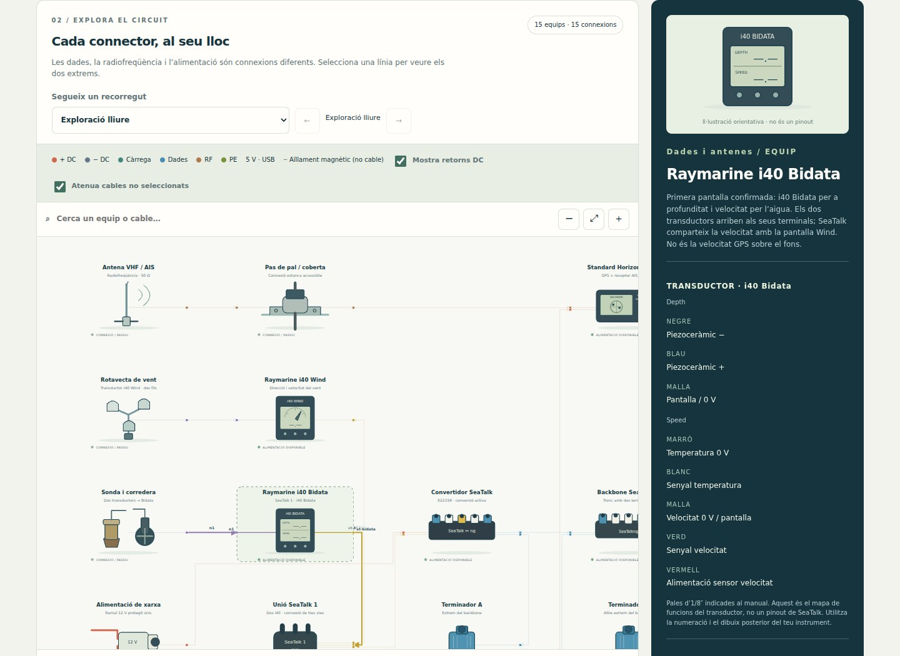
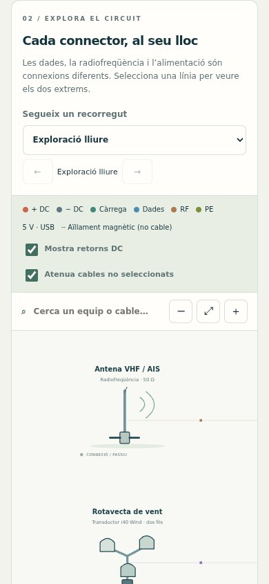

# Cablejat elèctric

Explora i documenta com es connecten els equips elèctrics d’un veler.

**[Obre el PWA / Open app](https://guirigall.github.io/CablejatElectric/)** · [Guia completa](docs/guia-completa.md) · [Incidències](https://github.com/Guirigall/CablejatElectric/issues)

[Català](#ca) · [Español](#es) · [English](#en)



<details>
<summary>Vista en mòbil / Mobile view</summary>



</details>

<a id="ca"></a>

## Català

Explora i documenta com es connecten els equips elèctrics d’un veler.

### Què hi trobaràs

- Xarxes de 12 V, dades/RF i alimentació de port de 230 V.
- GX2400E, i40 Bidata, i40 Wind, Axiom+ i conversió SeaTalk.
- Fitxes de cable, calibre, terminals A/B i càlcul de caiguda DC.
- Notes, importació JSON, exportació CSV, tema clar/fosc i tres idiomes.

### Comença

Tria una xarxa i toca un component o cable per obrir la fitxa. Segueix els recorreguts guiats i anota les referències i les mides reals del teu muntatge.

### Instal·lació

Obre l’aplicació amb HTTPS. A Android, fes servir Chrome → ⋮ → **Instal·la l’aplicació** o **Afegeix a la pantalla d’inici**. A iPhone: Safari → Compartir → **Afegeix a la pantalla d’inici**. Espera la confirmació de preparació sense connexió abans d’utilitzar el mode avió. No cal APK ni sideloading.

### Dades i límits

Funciona sense connexió després de preparar el PWA; els manuals externs necessiten Internet. Les seccions desconegudes queden pendents. És un atles funcional, no un plànol certificat de muntatge.

<a id="es"></a>

## Español

Explora y documenta cómo se conectan los equipos eléctricos de un velero.

### Qué ofrece

- Redes de 12 V, datos/RF y alimentación de puerto de 230 V.
- GX2400E, i40 Bidata, i40 Wind, Axiom+ y conversión SeaTalk.
- Fichas de cable, calibre, terminales A/B y caída de tensión DC.
- Notas, importación JSON, exportación CSV, tema claro/oscuro y tres idiomas.

### Primeros pasos

Elige una red y toca un componente o cable para abrir su ficha. Sigue los recorridos guiados y anota referencias y medidas reales de tu instalación.

### Instalación

Abre la aplicación por HTTPS. En Android: Chrome → ⋮ → **Instalar aplicación** o **Añadir a pantalla de inicio**. En iPhone: Safari → Compartir → **Añadir a pantalla de inicio**. Espera la confirmación de disponibilidad sin conexión antes de usar el modo avión. No necesita APK ni sideloading.

### Datos y límites

Funciona sin conexión tras preparar el PWA; los manuales externos requieren Internet. Las secciones desconocidas quedan pendientes. Es un atlas funcional, no un plano certificado de montaje.

<a id="en"></a>

## English

Explore and document how a sailing yacht’s electrical equipment connects.

### Features

- 12 V, data/RF and 230 V shore-power networks.
- GX2400E, i40 Bidata, i40 Wind, Axiom+ and SeaTalk conversion.
- Cable types, gauge criteria, end A/B terminals and DC voltage drop.
- Notes, JSON import, CSV export, light/dark themes and three languages.

### Getting started

Select a network and a component or wire to inspect it. Follow guided routes and record the actual cable references and dimensions of your installation.

### Installation

Open the HTTPS app URL. On Android: Chrome → ⋮ → **Install app** or **Add to home screen**. On iPhone: Safari → Share → **Add to Home Screen**. Wait for offline readiness before using airplane mode. No APK or sideloading is required.

### Data and limitations

Works offline once the PWA is prepared; external manuals need Internet. Unknown wire sizes remain pending. This functional atlas is not a certified installation plan.

## Novetats v1.8 / What's new in v1.8

- Esquema: botó ⤢ per veure tota la xarxa d’un cop, pessic amb dos dits, Ctrl + roda (o pessic del trackpad), arrossegar amb el ratolí, doble clic per apropar-se i centrat automàtic de l’element triat. / Diagram: ⤢ shows the whole network, two-finger pinch, Ctrl + wheel (or trackpad pinch), mouse drag, double-click to zoom in and automatic centring on the selected item.
- Mòbil: llista de connexions en targetes i capçalera més compacta. / Mobile: connection list as cards and a more compact header.
- El traçat de les altres xarxes es calcula en segon pla (`route-worker.js`): canviar a 12 V passa d’uns 1,4 s a uns 0,2 s en un mòbil lent. / Other networks are routed in the background: switching to 12 V drops from about 1.4 s to 0.2 s on a slow phone.

## Desenvolupament / Development

Des de la carpeta del repositori, amb Python 3 / From the repository folder, with Python 3:

```bash
python3 -m http.server 8080 --bind 127.0.0.1 --directory dist
```

Obre / Open `http://localhost:8080/`. Per instal·lar-lo des del mòbil, utilitza l’enllaç HTTPS del PWA.

Comprovacions incloses al repositori / Checks included in this repository:

```bash
npm test
python3 -m unittest discover -s tests -p test_server.py
```

Les captures es generen amb Chromium a partir del codi real del repositori, en contextos sense dades personals. Es poden renovar a **Actions → Captures del README → Run workflow**. Més detalls a [la guia completa](docs/guia-completa.md).
